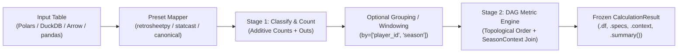

# Architecture Overview

## 1. Core Principles
1. **Pure Calculation Core**: `sabermetricspy` core computes metrics, expectancies, valuations, and forecasts over tables. It executes zero network requests and zero file scraping.
2. **Dataframe-Agnostic Vectorization**: Every formula is written once using `narwhals` expressions, executing natively on **Polars** (`DataFrame`/`LazyFrame`), **DuckDB** (`DuckDBPyRelation`), **PyArrow** (`Table`), and **pandas** (`DataFrame`) with zero per-row Python loops.
3. **Two-Stage Additive Pipeline**:
   - **Stage 1 (Classify & Count)**: Raw pitch/play records (`retrosheetpy`, `statcast`, `mlb_api`) are mapped into canonical additive count columns (`pa`, `ab`, `h`, `b2`, `b3`, `hr`, `bb`, `ibb`, `hbp`, `so`, `sf`, `sh`, `outs`, `swings`, `whiffs`, etc.).
   - **Stage 2 (Aggregate & Compute)**: Counts are summed across any user-specified grouping (`by=["player_id", "season"]`) or rolling window, and rate/ratio formulas are evaluated strictly from the summed counts. Ratios are **never** averaged.
4. **Innings Stored as Integer Outs**: Innings pitched are represented internally as integer `outs` (`1 IP = 3 outs`). Baseball display notation (`"6.2"` = 20 outs) is parsed at ingestion boundaries and formatted only for display.
5. **Immutable Results & Provenance**:
   - Stateless calculations return a frozen `CalculationResult` containing `.df` (native DataFrame), `.specs` (`dict[str, MetricSpec]`), `.context` (`SeasonContext`), and `.summary()`.
   - Fitted estimators (`RunExpectancyMatrix`, `CountExpectancyMatrix`, `LinearWeightsEstimator`, `MarcelProjector`, `Log5Model`, `MarkovChainModel`, `MonteCarloSimulator`) implement a `scikit-learn`-style `.fit()` / `.transform()` / `.predict()` interface with a frozen `statsmodels`-style `.results` diagnostics object (standard errors, confidence intervals, residuals, goodness-of-fit, seeded bootstrap intervals).
6. **Strict Null & Zero-Denominator Semantics**:
   - Missing counting stats coerce to `0` only at the ingestion preset boundary.
   - Missing physical measurements (`launch_speed`, `launch_angle`, `release_spin_rate`) remain `null`/`NaN`.
   - Any ratio with a `0` denominator evaluates to `null`/`NaN`—never `inf` or `ZeroDivisionError`.
7. **Every Metric Has Provenance**: Every metric is backed by a frozen Pydantic `MetricSpec` declaring its 3-tier naming (`Metric.WRC_PLUS`, `"wrc_plus"`, `"wRC+"`), category, implementation kind (`DETERMINISTIC`, `CONTEXTUAL`, `EMPIRICAL`, `MODELED`), required columns, dependent metrics, seasonal context requirements, LaTeX formula, primary citation, and caveats.

---

## 2. Package Layering & Dependency Direction

```text
sabermetricspy/
├── types/        # StrEnums (Metric, Stat, MetricSuite, Category, ImplKind, Direction,
│                 #           Handedness, PitchOutcome, PlayOutcome, BattedBallType, BaseState)
│                 # and frozen Pydantic value objects (Team, League, Park, SeasonContext)
├── schema/       # Canonical column schemas, alias resolution, innings-to-outs conversion,
│                 # null-handling rules, and Narwhals/Arrow type validation
├── constants/    # Loader and Pydantic models for bundled YAML seasonal constants
│                 # (wOBA weights, FIP constants, park factors, positional adjustments)
├── registry/     # MetricSpec, @register_metric decorator, DAG dependency solver,
│                 # MetricSuite expansion, and Python entry-point plugin discovery
├── metrics/      # Pure Narwhals expression functions organized by domain:
│   ├── batting.py        # AVG, OBP, SLG, OPS, ISO, BABIP, SecA, XBH%, HR%, BB%, K%, BB/K
│   ├── weighted.py       # wOBA, wRAA, wRC, wRC+, OPS+, Runs Created, BaseRuns
│   ├── pitching.py       # ERA, RA9, WHIP, H/9, BB/9, K/9, HR/9, K%, BB%, K-BB%, LOB%
│   ├── dips.py           # FIP, xFIP, kwERA, SIERA, DICE, ERA+, ERA-, FIP-, xFIP-
│   ├── discipline.py     # Swing%, Z-Swing%, O-Swing%, Contact%, Z-Contact%, O-Contact%, Whiff%, SwStr%, CStr%, CSW%
│   ├── batted_ball.py    # GB%, FB%, LD%, PU%, GB/FB, HR/FB, Pull%, Cent%, Oppo%, HardHit%, SweetSpot%, Barrel%, EV50
│   ├── baserunning.py    # SB%, Steal Breakeven, wSB, Speed Score
│   ├── fielding.py       # FPCT, RF/9, RF/G, DER, Catcher CS%
│   └── team.py           # Pythagorean Win%, Pythagenpat, Expected Wins, Pythag Luck, Run Diff
├── engine/       # Two-stage execution engine: preset mapping -> grouping/windowing ->
│                 # topological DAG ordering -> Narwhals expression evaluation -> CalculationResult
├── expectancy/   # Empirical play-by-play & pitch-level state models:
│   ├── states.py         # 24 base-out states & 288 count-base-out states
│   ├── re24.py           # RunExpectancyMatrix (RE24, play run values, Empirical Bayes smoothing)
│   ├── re288.py          # CountExpectancyMatrix (RE288, pitch run values, count leverage)
│   ├── linear_weights.py # Empirical linear weights & wOBA weight derivation from play-by-play
├── value/        # Composite player valuation:
│   ├── park.py           # Park factor adjustments
│   ├── replacement.py    # Replacement level & runs-per-win (RPW) conversions
│   └── war.py            # Modular WARFramework (position players, FIP-based & RA9-based pitchers)
├── models/       # Forecasting, matchup, and simulation models:
│   ├── base.py           # FittedModel Protocol, ModelResults frozen diagnostics
│   ├── marcel.py         # Marcel the Monkey forecasting system (batting & pitching)
│   ├── log5.py           # Log5 / Bradley-Terry matchup & team win probability models
│   ├── markov.py         # Exact 24-state absorbing Markov chain inning/game run estimator
│   ├── monte_carlo.py    # Seeded Monte Carlo game/season simulator
│   └── expected.py       # Savant xBA / xSLG / xwOBA field sums
├── uncertainty/  # Analytical binomial/normal intervals & seeded bootstrap estimator
├── presets/      # Source column & event-code mappers (retrosheetpy, statcast, lahman, mlb_api)
├── adapters/     # Optional thin bridges for external libraries
└── data/         # Bundled YAML files:
    ├── constants/        # woba_fangraphs.yaml, fip_constants.yaml, park_factors.yaml
    ├── presets/          # retrosheetpy.yaml, statcast.yaml, lahman.yaml
    └── entities/         # leagues.yaml, parks.yaml
```

**Dependency Rule**:
`adapters -> presets -> engine -> (metrics | expectancy | value | models | uncertainty) -> registry -> constants -> schema -> types`.
Lower layers never import from higher layers.

---

## 3. Constants Provenance & Park Factors

Seasonal constants are bundled FanGraphs data (`data/constants/woba_fangraphs.yaml`, 1990-2026). Each entry records
its source and retrieval date; league ERA/FIP/xFIP/HR-FB and non-pitcher wRC/PA are optional and absent when
unpublished (xFIP is null before 2002). Requesting an unbundled season returns the nearest season and emits a
`UserWarning`. Park factor is a caller input (`SeasonContext.park_factor`, 100 = no adjustment):

```python
import polars as pl
import sabermetricspy as sp
from sabermetricspy import Metric
from sabermetricspy.types.context import SeasonContext

df = pl.DataFrame(
    {
        "player_id": ["x"],
        "pa": [664],
        "ab": [476],
        "h": [156],
        "b2": [32],
        "b3": [2],
        "hr": [73],
        "bb": [177],
        "ibb": [35],
        "hbp": [9],
        "sf": [2],
        "so": [93],
    }
)
ctx = SeasonContext(season=2001, league="NL", park_factor=96.0)  # FanGraphs 5-year park factor
print(
    sp.calculate(df, [Metric.WRC_PLUS], context=ctx).df["wrc_plus"][0]
)  # ~234.4 (FanGraphs: 234.59)
```

---

## 4. Data Flow Diagram


